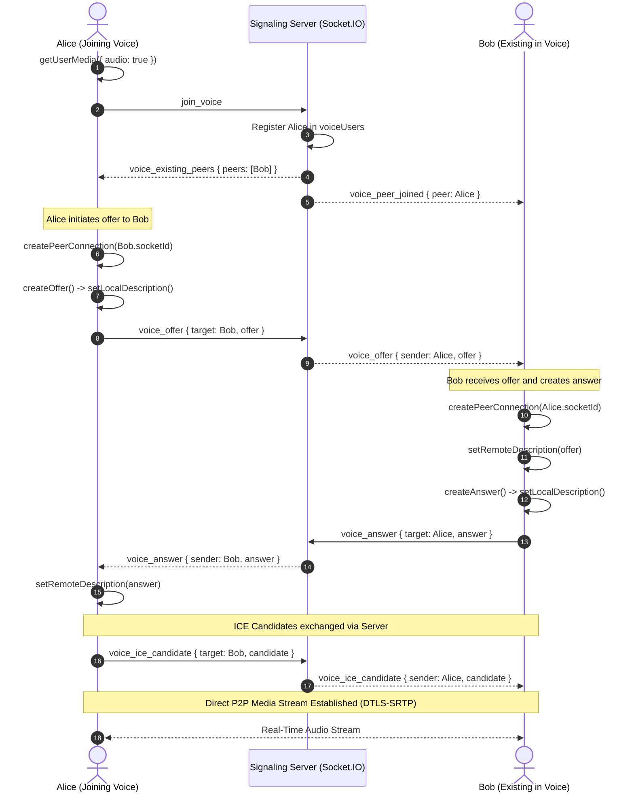

# ChatterBox — Current Architecture

**System Architecture & Technical Topology**  
**Version**: 1.0.0-poc  
**Last Updated**: November 17, 2026  

---

## 1. High-Level Architecture Diagram

```mermaid
flowchart TD
    subgraph Clients["Client Tier (Web & Mobile Browsers)"]
        ClientA["Browser Client A<br/>(Vanilla JS + WebRTC)"]
        ClientB["Browser Client B<br/>(Vanilla JS + WebRTC)"]
        ClientC["Browser Client C<br/>(Vanilla JS + WebRTC)"]
    end

    subgraph Edge["Edge / Reverse Proxy Tier"]
        Tunnel["Public Tunnel / Reverse Proxy<br/>(TLS Termination :443)"]
    end

    subgraph Server["Application Server Tier (Node.js 24)"]
        Express["Express 5 Server<br/>(Static Assets & Security Headers)"]
        SocketServer["Socket.IO v4 Engine<br/>(WebSocket Transport)"]
        AntiSpam["Anti-Spam & Rate Limiter<br/>(Token Bucket + Duplicate Filter)"]
        
        subgraph MemoryStore["In-Memory State (Process Memory)"]
            UsersMap["users: Map&lt;socket.id, User&gt;"]
            VoiceMap["voiceUsers: Map&lt;socket.id, VoiceUser&gt;"]
            HistoryMap["messageHistory: Map&lt;room, Message[]&gt;"]
            RoomsSet["customRooms: Set&lt;string&gt;"]
        end
    end

    subgraph Signaling["WebRTC Signaling & P2P VoIP"]
        STUN["Google Public STUN<br/>(stun.l.google.com:19302)"]
    end

    ClientA <-->|HTTPS / WSS| Tunnel
    ClientB <-->|HTTPS / WSS| Tunnel
    ClientC <-->|HTTPS / WSS| Tunnel

    Tunnel <-->|HTTP / WS :3001| Express
    Express --> SocketServer
    SocketServer --> AntiSpam
    AntiSpam <--> MemoryStore

    ClientA <-.->|ICE Discovery| STUN
    ClientB <-.->|ICE Discovery| STUN
    ClientC <-.->|ICE Discovery| STUN

    ClientA <===>|WebRTC P2P Audio Mesh<br/>(DTLS-SRTP)| ClientB
    ClientB <===>|WebRTC P2P Audio Mesh<br/>(DTLS-SRTP)| ClientC
    ClientA <===>|WebRTC P2P Audio Mesh<br/>(DTLS-SRTP)| ClientC
```

---

## 2. Component Breakdown

### 2.1 Backend (`server.js`)
- **HTTP Server**: An `http.createServer(app)` instance binding to port `process.env.PORT` (defaults to 3000, with automated fallback to 3001 if occupied).
- **Static Asset Handler**: Serves `./public` directory with `compression` and conditional `ETag` caching.
- **Security Middleware**: `helmet()` enforcing strict Content Security Policy directives, framing rules, and MIME sniff deterrence.
- **Socket.IO Event Hub**:
  - Manages client connection lifecycles.
  - Maintains in-memory user sessions and room memberships.
  - Relays text messages, reaction counters, typing states, and status updates.
  - Acts as a WebRTC signaling mediator, relaying SDP offers, SDP answers, and ICE candidates between browser peers.
  - Enforces spam rate limiting (max 3 messages per 2-second burst) and duplicate content blocking.

### 2.2 Frontend Client (`public/`)
- **`index.html`**:
  - Semantic layout comprising a collapsible navigation drawer, channel selector, VoIP active roster, member roster, user profile footer, chat workspace, message feed, reaction bars, and input controls.
- **`style.css`**:
  - Custom CSS responsive design system supporting desktop, tablet, and mobile form factors.
  - Dynamic viewport sizing (`100dvh`), iOS Safari auto-zoom countermeasures, touch momentum scrolling, and safe area insets.
- **`client.js`**:
  - Connects to Socket.IO using WebSocket transport priority.
  - Manages DOM lifecycle using `DocumentFragment` batching and capped DOM nodes (max 200 elements in feed).
  - Handles WebRTC `RTCPeerConnection` instantiation, audio stream routing, and per-peer HTML `<audio>` volume adjustments.
  - Monitors local voice activity through native `AudioContext` and `AnalyserNode` to toggle speaking halo indicators.

---

## 3. Real-Time Data Flows

### 3.1 Text Messaging Flow

```mermaid
sequenceDiagram
    autonumber
    actor Alice as Alice (Client A)
    participant Server as Socket.IO Server
    actor Bob as Bob (Client B)

    Alice->>Server: send_message { text: "Hello team!" }
    Server->>Server: Anti-Spam Check (Rate Limit & Duplicate)
    alt Spam Detected
        Server-->>Alice: spam_warning { text: "Cooldown...", cooldown: 5 }
    else Allowed
        Server->>Server: Sanitize & Append to messageHistory[room]
        Server-->>Alice: new_message { id, text, username, ... }
        Server-->>Bob: new_message { id, text, username, ... }
        Note over Alice,Bob: Message rendered in DOM; Audio ping played
    end
```

### 3.2 WebRTC VoIP Mesh Signaling Flow



---

## 4. Current In-Memory Data Models

```typescript
interface User {
  id: string;               // Socket connection identifier (socket.id)
  publicId: string;         // Random 8-byte hex string exposed to other clients
  username: string;         // User display name (max 24 characters)
  room: string;             // Current active channel identifier
  avatarColor: string;      // Assigned hex color code
  status: 'online' | 'away' | 'busy';
  rateLimitWindow: number;  // Epoch timestamp of rate limit burst start
  msgCount: number;         // Count of messages sent in current window
  cooldownUntil: number;    // Epoch timestamp until spam cooldown expires
  lastMsgText: string;      // Last message sent for duplicate detection
  dupCount: number;         // Count of consecutive duplicate messages
}

interface VoiceUser {
  socketId: string;         // Socket identifier
  publicId: string;         // Opaque public user ID
  username: string;         // User display name
  avatarColor: string;      // Assigned hex color
  room: string;             // Voice channel name
  isMuted: boolean;         // Microphone mute state
}

interface Message {
  id: string;               // Unique message identifier
  senderId: string;         // Opaque public ID of sender
  username: string;         // Sender display name
  avatarColor: string;      // Sender avatar color
  text: string;             // Sanitized message body
  room: string;             // Destination channel
  reactions: Record<string, string[]>; // Map of emoji -> publicId[]
  timestamp: string;        // ISO 8601 string
}
```

---

## 5. Network & Deployment Topology

- **Process Binding**: Single Node.js thread on `0.0.0.0:3001` (with dynamic fallback if 3000 is occupied).
- **Public Ingress**: Secured over TLS via a reverse proxy/tunnel exposing an external HTTPS/WSS endpoint (`https://24055030ffe552.app.lhr.life`).
- **STUN Discovery**: STUN binding requests directed to `stun.l.google.com:19302` on UDP port 19302 to resolve public IP and port mappings across NAT/firewalls.
- **Media Encryption**: Audio media packets are protected by DTLS-SRTP mandatory in standard WebRTC implementations.
